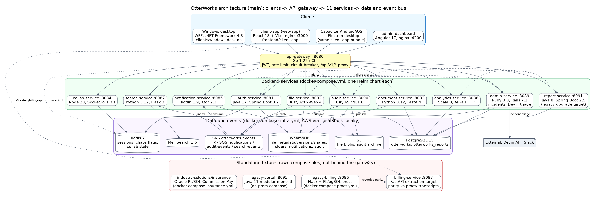

# OtterWorks Architecture

OtterWorks is a polyglot cloud file-storage and document-collaboration platform
(Google Drive-like). This page describes what the code on `main` does today. The
request-level sequence diagrams live in [docs/flows.md](docs/flows.md) and the hosted
demo platform (EKS tenants, ops dashboard, reaper) in
[demo-platform/docs/architecture.md](demo-platform/docs/architecture.md).



The diagram source is [`docs/diagrams/architecture.dot`](docs/diagrams/architecture.dot)
(Graphviz). Edit it and run `docs/diagrams/render.sh` to regenerate
`architecture.png` and `architecture.svg`.

## Layers at a glance

| Layer | What runs | Defined in |
|-------|-----------|------------|
| Clients | `client-app` web/mobile/desktop, `admin-dashboard`, Windows WPF client | `frontend/`, `clients/` |
| Edge | `api-gateway` (Go) | `services/api-gateway` |
| Core services | 10 services behind the gateway | `services/*`, `docker-compose.yml` |
| Data and events | PostgreSQL, Redis, MeiliSearch, DynamoDB, S3, SNS/SQS | `docker-compose.infra.yml`, `scripts/localstack-init.sh`, `infrastructure/terraform` |
| Batch | Cron-driven Python ETL jobs | `etl/` |
| Modernization fixtures | Legacy billing + extracted billing service, legacy portal monolith, Oracle insurance package | `services/legacy-*`, `services/billing-service`, `services/industry-solutions`, `procs/` |
| Ops | Observability, security gates, Helm/Terraform, demo platform | `docker-compose.infra.yml`, `security/`, `infrastructure/`, `platform/`, `demo-platform/` |

## Clients

| Client | Stack | Notes |
|--------|-------|-------|
| `frontend/client-app` | React 18, TypeScript, Vite, Tailwind, Zustand, TanStack Query | Served by nginx on `:3000` (compose service name `web-app`). Talks to the gateway at `VITE_API_URL` and to collab-service over WebSocket (`VITE_COLLAB_WS_URL`, `:8084`). The Vite dev server also proxies `/billing-api` to `billing-service`. |
| Capacitor Android/iOS, Electron desktop | Same `client-app` bundle | Capacitor config in `capacitor.config.ts` + `mobile/`; Electron shell in `desktop/` |
| `frontend/admin-dashboard` | Angular 17, Angular Material, NgRx | Served on `:4200`; calls `/api/v1/admin/*` and analytics/audit through the gateway. |
| `clients/windows-desktop` | WPF, .NET Framework 4.8, MVVM | Native Windows client for the same gateway API (sign in, browse files, edit documents). Built on Windows only. |

## API gateway

`services/api-gateway` (Go 1.22, Chi) is the single entry point on `:8080`. It
validates JWTs, applies per-client rate limits, wraps each upstream in a circuit
breaker, adds request IDs and CORS, and reverse-proxies by path prefix
(`internal/config/config.go`):

| Prefix | Upstream |
|--------|----------|
| `/api/v1/auth`, `/api/v1/settings` | auth-service |
| `/api/v1/files`, `/api/v1/folders` | file-service |
| `/api/v1/documents`, `/api/v1/templates` | document-service |
| `/api/v1/collab`, `/socket.io` | collab-service |
| `/api/v1/notifications`, `/api/v1/preferences` | notification-service |
| `/api/v1/search` | search-service |
| `/api/v1/analytics` | analytics-service |
| `/api/v1/admin` | admin-service |
| `/api/v1/audit` | audit-service |
| `/api/v1/reports` | report-service |

## Core services

| Service | Port | Stack | Owns |
|---------|------|-------|------|
| auth-service | 8081 | Java 17, Spring Boot 3.2 | Registration, login, JWT issue/refresh, OAuth2, RBAC, user settings. PostgreSQL + Redis. |
| file-service | 8082 | Rust, Actix-Web 4 | Upload/download, folders, versions, sharing, trash. Blobs in S3, metadata in DynamoDB; publishes file events to SNS; reports storage failures to admin-service. |
| document-service | 8083 | Python 3.12, FastAPI, SQLAlchemy | Documents, templates, comments, version history. PostgreSQL; publishes document events to SNS. |
| collab-service | 8084 | Node 20, TypeScript, Socket.io, Yjs | Real-time co-editing (CRDT), cursors and presence. Redis adapter for state and fan-out. |
| notification-service | 8086 | Kotlin 1.9, Ktor 2.3 | Consumes the `otterworks-notifications` SQS queue, stores notifications and preferences in DynamoDB, pushes over WebSocket, sends alerts to admin-service. |
| search-service | 8087 | Python 3.12, Flask 3 | Full-text search over MeiliSearch; indexes from the `otterworks-search-events` queue. |
| analytics-service | 8088 | Scala 3, Akka HTTP | Usage metrics and dashboards from the shared PostgreSQL database. |
| admin-service | 8089 | Ruby 3.3, Rails 7.1, Sidekiq | Users, quotas, feature flags, announcements, system health, incidents. Its incident path opens Devin triage sessions and Slack alerts. PostgreSQL + Redis. |
| audit-service | 8090 | C#, ASP.NET Core 8 | Consumes `otterworks-audit-events`; audit log in DynamoDB, archives to S3. |
| report-service | 8091 | Java 8, Spring Boot 2.5, JasperReports, Maven | **Legacy on purpose**: PDF/CSV/Excel reports over the `otterworks_reports` database, pulling data from analytics, audit and auth. Upgrade path in `services/report-service/UPGRADE_GUIDE.md`. |

There is no service on 8085; collab-service serves HTTP and WebSocket on 8084.

## Data and events

Locally, `docker-compose.infra.yml` runs PostgreSQL 15, Redis 7 and MeiliSearch 1.6;
LocalStack emulates AWS and `scripts/localstack-init.sh` creates:

- **S3**: `otterworks-files`, `otterworks-audit-archive`, `otterworks-data-lake`
- **DynamoDB**: file metadata, file versions, folders, shares, notifications, preferences, audit events
- **SNS → SQS**: topic `otterworks-events` fans out to `otterworks-notifications`,
  `otterworks-audit-events` and `otterworks-search-events` (each with a DLQ).

`scripts/init-db.sql` creates the `otterworks` and `otterworks_reports` PostgreSQL
databases. In AWS the same resources come from `infrastructure/terraform/modules`
(`database`, `cache`, `search`, `storage`, `messaging`, `auth`, `irsa`, `monitoring`).
Demo tenants run with SNS/SQS disabled (see [AGENTS.md](AGENTS.md)).

## Batch ETL

`etl/` holds plain Python jobs run by cron through `etl/run.sh` (schedule in `etl/crontab`):

| Job | Schedule (UTC) |
|-----|----------------|
| `analytics_daily.py` | daily 02:00 |
| `storage_cleanup_daily.py` | daily 02:30 |
| `user_activity_daily.py` | daily 05:00 |
| `audit_archive_weekly.py` | Sunday 03:00 |
| `search_reindex_weekly.py` | Sunday 04:00 |

`etl/ETL_UPGRADE_GUIDE.md` describes the move to an orchestrated pipeline.

## Modernization fixtures

These run from their own compose files, are not routed by the gateway and are not
part of the Helm deploy. They exist to demo legacy-to-modern migrations.

| Path | What it is | Run with |
|------|-----------|----------|
| `services/legacy-billing` (`:8096`) | Flask app whose billing logic lives in PL/pgSQL stored procedures (the "before" state) | `make procs-up` (`docker-compose.procs.yml`) |
| `services/billing-service` (`:8097`) | FastAPI service the procedures are extracted into (the "after" state), with its own database | `make procs-up` |
| `procs/` | Record/replay harness: scenarios, recorded transcripts and parity rules that prove `billing-service` matches `legacy-billing` (`procs-parity.yml` in CI) | `make procs-record`, `make procs-parity` |
| `services/legacy-portal` (`:8095`) | Java 11 Spring Boot modular monolith (announcements, feedback, user preferences) for decomposition demos, deployed on-prem style | `services/legacy-portal/docker-compose.onprem.yml` |
| `services/industry-solutions/insurance` | Oracle PL/SQL "Commission Pay" package with OLTP/OLAP schemas | `make insurance-up` (`docker-compose.insurance.yml`) |

## Observability

`docker-compose.infra.yml` also runs Prometheus, Grafana, Jaeger, an OpenTelemetry
collector and Fluent Bit, configured from `observability/` (Prometheus scrape, alert and
recording rules; Grafana provisioning and dashboards; OTel collector; Fluent Bit). Services
export OTLP traces to the collector, and most expose Prometheus metrics.

## Security and quality gates

| Path | Purpose |
|------|---------|
| `security/scanning` | Trivy config used by `security-scan.yml` |
| `security/dast` | OWASP ZAP baseline against the running stack (`dast-scan.yml`) |
| `security/deps` | Dependency advisory cases and expected results (`deps-remediation.yml`) |
| `security/equivalence` | Behavioural equivalence cases for refactors (`equivalence-gate.yml`) |
| `security/policies` | Default-deny Kubernetes NetworkPolicies |
| `tests/api`, `tests/contract` | Cross-service API flow tests (`make test-api-flows`) and consumer contracts |

## Deployment

- **Kubernetes**: one Helm chart per deployable in `infrastructure/helm/` (11 backend
  services plus `web-app` and `admin-dashboard`); namespace, quota and limit range in
  `infrastructure/k8s/`.
- **AWS base**: `platform/terraform` (VPC, EKS, ECR) and
  `infrastructure/terraform` (application data stores and IRSA).
- **Demo platform**: `demo-platform/` runs per-attendee tenants on the shared
  `otterworks-dev` cluster; see its [architecture doc](demo-platform/docs/architecture.md).
- **CI/CD** (`.github/workflows`): `ci.yml` (path-filtered build and test per service),
  `security-scan.yml`, `dast-scan.yml`, `deps-remediation.yml`, `equivalence-gate.yml`,
  `procs-parity.yml`, `sast-auto-remediate.yml`, `docker-build.yml`, `cd-tenant.yml`
  (tenant deploys for `workshop-*`/`demo-*` branches) and `mirror-demo.yml`.

## Repository layout

```
otterworks/
├── services/                 # api-gateway + 10 core services + modernization fixtures
├── frontend/
│   ├── client-app/           # React + Vite web app (+ Capacitor, Electron)
│   └── admin-dashboard/      # Angular admin console
├── clients/windows-desktop/  # WPF native client
├── procs/                    # stored-procedure parity harness
├── etl/                      # cron ETL jobs
├── security/                 # SAST/DAST/deps/equivalence gates, network policies
├── tests/                    # API flow and contract tests
├── infrastructure/           # Helm charts, k8s base, app Terraform
├── platform/terraform/       # VPC, EKS, ECR
├── demo-platform/            # multi-tenant demo control plane
├── observability/            # Prometheus, Grafana, OTel collector, Fluent Bit config
├── scripts/                  # local init, deploy, tenant tooling
└── docs/                     # flows, runbooks, diagrams
```
